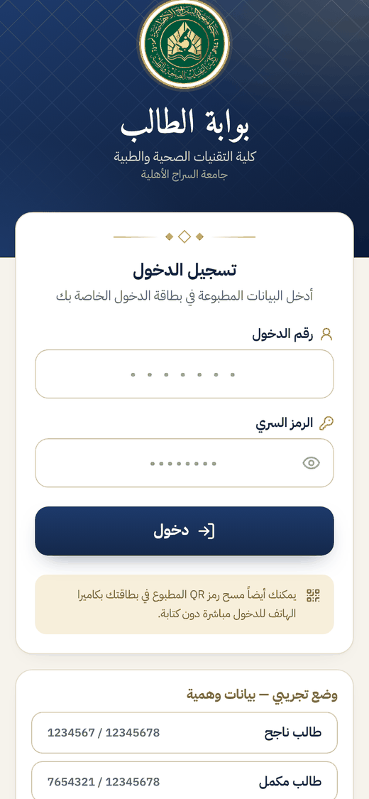
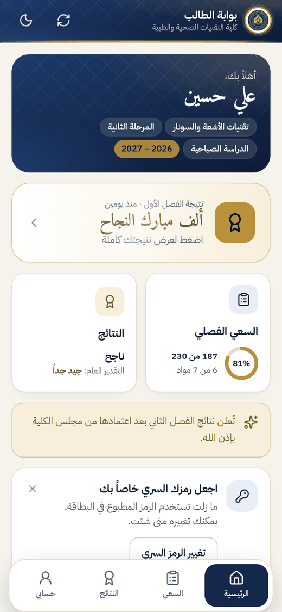
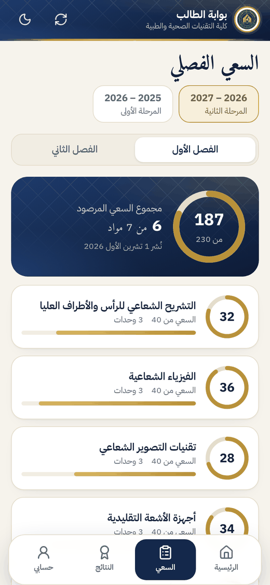
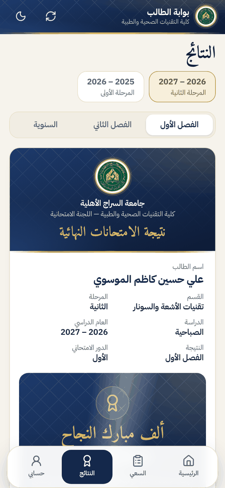

<div dir="rtl">

<p align="center">
  
</p>

<h1 align="center">بوابة الطالب</h1>
<p align="center">كلية التقنيات الصحية والطبية — جامعة السراج الأهلية</p>
<p align="center">إعداد وتطوير: م.م سفيان محمد</p>

تطبيق ويب عربي (RTL) مخصص للهواتف الذكية، يطّلع الطالب من خلاله على **سعيه الفصلي** في كل المواد وعلى **نتيجة امتحاناته النهائية** فور إعلانها من اللجنة الامتحانية. يُثبَّت كتطبيق من المتصفح (PWA) ويعمل كذلك على الحواسيب والأجهزة اللوحية.

التطبيق **منفصل تماماً** عن [نظام إدارة اللجنة الامتحانية](https://github.com/Sofianiq/Exam): مستودع مستقل وموقع مستقل، فلا يضيف أي عبء على النظام الرئيسي، لكنه يقرأ من قاعدة البيانات نفسها على **Supabase** ما تنشره اللجنة فقط.

<p align="center">
  
  
  
  
</p>
<p align="center"><sub>اللقطات من الوضع التجريبي، وكل الأسماء والدرجات فيها وهمية.</sub></p>

---

## ما يراه الطالب

| الشاشة | المحتوى |
|---|---|
| **الرئيسية** | ترحيب باسم الطالب وقسمه ومرحلته، آخر نتيجة معلنة، ملخص السعي، إعلانات الكلية والقسم الموجهة إلى الطلبة، وتنبيه «جديد» عند نشر أي شيء لم يطّلع عليه بعد. |
| **السعي** | **السعي الكامل** لكل مادة فقط (مثال: نظري 20 + عملي 12 تظهر **32 من 40**) دون أي تفصيل، مع حلقة ملونة لكل مادة ومجموع السعي المرصود للفصل. المادة التي لم يُرصد سعيها تظهر بعبارة «لم يُرصد بعد». |
| **النتائج** | «نتيجة الامتحانات النهائية» بتصميم وثيقة أكاديمية: **التقديرات فقط** (امتياز، جيد جداً …) دون درجات، نتيجة كل مادة، التقدير العام، مجموع الوحدات، و**الحالة النهائية** (ناجح، ناجح بقرار، ناجح بالتحميل، مكمل، راسب) لكل فصل وللنتيجة السنوية، مع ذكر المواد المكمل أو الراسب فيها. للناجح تهنئة «**ألف مبارك النجاح**» مع احتفال بصري، وشارة «من الأوائل» مع الترتيب للعشرة الأوائل على المرحلة. يمكن **حفظ النتيجة PDF** بصفحة A4 واحدة، وعليها رمز QR يفتح صفحة التحقق الرسمية. |
| **حسابي** | بيانات الطالب، **السجل الأكاديمي** لكل سنواته، **تغيير الرمز السري** (اختياري)، الوضع الليلي، تثبيت التطبيق، تسجيل الخروج. |

مزايا أخرى: الدخول **بمسح رمز QR** من بطاقة الدخول، قبول الأرقام العربية والهندية، بقاء الجلسة 60 يوماً، عرض **آخر نسخة محفوظة عند انقطاع الإنترنت**، وضع ليلي، وتحديث تلقائي للتطبيق.

## كيف يرتبط بنظام اللجنة الامتحانية؟

```
نظام اللجنة الامتحانية (Exam)                         بوابة الطالب (هذا المستودع)
┌───────────────────────────────┐                  ┌──────────────────────────┐
│ صفحة «بوابة الطلبة»            │                  │ تطبيق ثابت على GitHub Pages │
│  • إنشاء حسابات الطلبة وبطاقاتهم │                  │  • أربع دوال فقط:           │
│  • نشر السعي / النتائج لكل شعبة │   Supabase       │    دخول، تحديث، تغيير رمز،  │
│  • إلغاء النشر، غلق البوابة     │ ───────────────▶ │    خروج                   │
│  • إعلانات موجهة للطلبة        │  نسخة منشورة      │  • لا يصل إلى جداول الدرجات │
└───────────────────────────────┘  لكل طالب         └──────────────────────────┘
```

- **الأسماء** تُؤخذ من نظام اللجنة مباشرة؛ لا يُدخَل أي اسم هنا.
- **النشر صريح:** لا يظهر للطالب سعي ولا نتيجة إلا بعد أن يضغط مدير النظام أو العميد زر «نشر» للشعبة والفصل المعنيين. عند النشر تُحفظ لكل طالب **نسخة جاهزة** تحتوي ما يحق له رؤيته فقط (مجموع السعي، أو التقديرات والحالة)، فلا تصل الدرجات التفصيلية إلى هاتف الطالب إطلاقاً.
- **النتائج لا تُنشر** قبل اعتماد كل مواد الفصل. وإذا تغيّرت درجة بعد النشر يظهر للجنة تنبيه «تغيّرت بعد النشر» لإعادة النشر.
- **المسؤول عن البوابة** هو مدير نظام اللجنة الامتحانية (والعميد)، ولمقرر القسم طباعة بطاقات طلبة قسمه وتجديد رمز من نسي رمزه.

## الأمان والخصوصية

- لكل طالب **رقم دخول** من 7 أرقام و**رمز سري** من 8 أرقام يُطبعان على بطاقة صغيرة. الرموز مخزنة **مشفرة (bcrypt)**، وبعد أن يغيّر الطالب رمزه لا يستطيع أحد الاطلاع عليه؛ يمكن فقط إصدار رمز جديد له.
- **قفل تلقائي** بعد 5 محاولات خاطئة خلال 15 دقيقة (و20 خلال يوم) لكل رقم دخول، وحد للمحاولات من العنوان نفسه.
- الطالب لا يملك أي صلاحية على جداول النظام: كل جداول البوابة مغلقة بصلاحيات الصفوف (RLS) ولا تُقرأ إلا عبر دوال الدخول.
- يرى الطالب بياناته هو فقط، ولا تظهر أسماء أو درجات غيره.
- عند تسجيل الخروج تُمسح البيانات المحفوظة على الجهاز.
- غلق البوابة من نظام اللجنة يوقفها فوراً لكل الطلبة.

---

## التشغيل — خطوة بخطوة

> المتطلب الوحيد: أن يكون [نظام اللجنة الامتحانية](https://github.com/Sofianiq/Exam) مُعدّاً على Supabase.

### 1) تحديث قاعدة البيانات (مرة واحدة)
في مستودع نظام اللجنة افتح `supabase/schema.sql` وانسخ محتواه كاملاً، ثم في لوحة Supabase: **SQL Editor ← New query ← الصق ← Run**. الملف يضيف جداول البوابة ودوالها فقط ولا يحذف أي بيانات.

### 2) إعداد هذا المستودع
1. **Settings ← Secrets and variables ← Actions ← Variables ← New repository variable** وأضف المتغيرين بالقيم نفسها المستخدمة في مستودع نظام اللجنة:

   | الاسم | القيمة |
   |---|---|
   | `SUPABASE_URL` | رابط المشروع، مثل `https://xxxx.supabase.co` |
   | `SUPABASE_ANON_KEY` | مفتاح **Publishable** (أو anon) |

2. **Settings ← Pages ← Source ← GitHub Actions**.
3. **Actions ← Deploy to GitHub Pages ← Run workflow**. بعد دقيقتين يصبح الموقع متاحاً على:
   `https://sofianiq.github.io/student-results/`

> بدون المتغيرين يُبنى الموقع في **الوضع التجريبي** ببيانات وهمية، ويظهر ذلك في أسفل صفحة «حسابي».

### 3) التفعيل من نظام اللجنة الامتحانية
ادخل بحساب مدير النظام ثم افتح **«بوابة الطلبة»** من القائمة الجانبية:
1. **الإعدادات:** الصق رابط البوابة أعلاه وفعّل «البوابة مفتوحة للطلبة».
2. **إنشاء الحسابات الناقصة:** يُنشأ حساب لكل طالب (والطالب الذي له حساب من سنة سابقة يحتفظ به).
3. **البطاقات:** اطبع بطاقات كل شعبة (8 بطاقات في صفحة A4)، وعلى كل بطاقة رقم الدخول والرمز السري ورمز QR للدخول المباشر.
4. **النشر:** انشر «سعي الفصل الأول» عند اكتماله، ثم «نتيجة الفصل الأول» بعد اعتماد المواد، وهكذا للفصل الثاني والنتيجة السنوية.
5. **الإعلانات:** من صفحة الإعلانات اختر الفئة «الطلبة» ليظهر الإعلان في البوابة.

### 4) ما يفعله الطالب
- يفتح الرابط أو **يمسح رمز QR** من بطاقته، فيدخل مباشرة.
- **التثبيت على Android (Chrome):** القائمة ⋮ ← «تثبيت التطبيق» أو «إضافة إلى الشاشة الرئيسية».
- **التثبيت على iPhone (Safari):** زر المشاركة ← «إضافة إلى الشاشة الرئيسية».
- يمكنه تغيير رمزه السري من «حسابي» إن رغب. من نسي رمزه يراجع مقرر القسم لإصدار رمز جديد.

---

## التجربة السريعة (الوضع التجريبي)

```bash
npm install
```
```bash
npm run dev
```

ثم ادخل بأحد الحسابين الوهميين:

| رقم الدخول | الرمز السري | الحالة |
|---|---|---|
| `1234567` | `12345678` | طالب ناجح ومن الأوائل، مع سنة سابقة بنتيجة سنوية |
| `7654321` | `12345678` | طالبة مكملة في مادتين |

للربط بقاعدة البيانات محلياً انسخ `.env.example` إلى `.env` واكتب قيم Supabase.

## البنية التقنية

- **الواجهة:** React 19 + TypeScript + Tailwind CSS 4 + Vite، خطّا IBM Plex Sans Arabic و Amiri، PWA يعمل دون اتصال.
- **الحجم:** خفيف عمداً؛ لا مكتبة Supabase ولا مكتبة توجيه — أربع طلبات `fetch` مباشرة.
- **قاعدة البيانات:** دوال `portal_login` و`portal_me` و`portal_change_code` و`portal_logout` المعرّفة في `supabase/schema.sql` ضمن مستودع نظام اللجنة.

```
src/
  lib/         الاتصال (api)، الجلسة والتخزين (store)، منطق العرض (logic)، بيانات تجريبية (demo)
  components/  مكونات مشتركة: الشعار، الحلقة، رمز QR، الاحتفال
  views/       الدخول، الرئيسية، السعي، النتائج، حسابي
scripts/e2e.cjs اختبار شامل للواجهة عبر Playwright (الوضع التجريبي)
```

## الاختبارات

```bash
npm test
```
```bash
npm run build && npx vite preview --port 4180
```
```bash
node scripts/e2e.cjs
```

- `npm test`: اختبارات منطق العرض (مجموع السعي، رسائل النتيجة، رابط الدخول بالرمز).
- `scripts/e2e.cjs`: يمر على الدخول والسعي والنتائج وحفظ PDF وتغيير الرمز والدخول برمز QR والوضع الليلي على مقاس هاتف.
- صلاحيات قاعدة البيانات ودوال البوابة مختبرة في مستودع نظام اللجنة (`npm run test:db`).

</div>
